

# Tv Vetrina

**Video, musica ed eliminacode sulla TV del negozio.** 
Si comanda dal telefono e dal telecomando, e funziona anche senza internet.

 

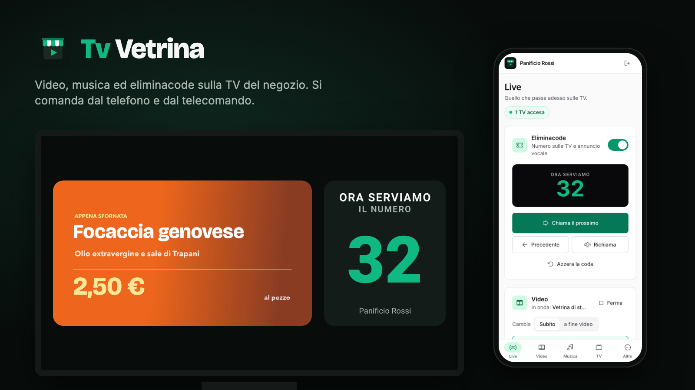

 

## Come si presenta

  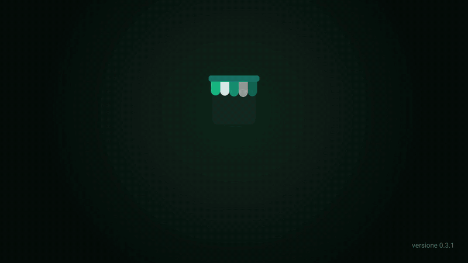

> All'accensione la TV apre da sola Tv Vetrina e riparte con i video e la musica scaricati.
> Con la freccia destra del telecomando si chiama il numero successivo: compare a tutto schermo e viene annunciato a voce.

🎬 **[Guarda il video dimostrativo (51 secondi)](media/demo.mp4)**

 

## Cosa fa

| | Funzione | In breve |
|:---:|---|---|
| 🎞️ | **Vetrina** | Video a tutto schermo in loop: offerte, prodotti, orari. File MP4 scaricati sulla TV oppure video di YouTube e Vimeo. |
| 🎵 | **Sottofondo** | Musica di sottofondo per il negozio: MP3 scaricati, radio in streaming o YouTube. Si abbassa da sola quando si chiama un numero. |
| 🎫 | **Turno** | Eliminacode: il numero chiamato compare sulla TV, con un "ding" e la voce che dice *"Serviamo il numero 32"*. |

- **Funziona offline.** I video e la musica restano sulla TV: se cade la connessione si continua come prima, coda compresa.
- **Una playlist alla volta.** Ne prepari quante vuoi e dal telefono scegli quale va in onda, subito o alla fine del video in corso.
- **Più TV, stessa attività.** Tutte le TV del negozio mostrano gli stessi contenuti e lo stesso numero.
- **Tasti grandi.** Pensata per chi sta al banco: si usa solo con le frecce e il tasto OK.
- **Il server è tuo.** Gira su un normale hosting PHP, senza database e senza abbonamenti.

 

## Sulla TV

<table>
  <tr>
    <td width="50%">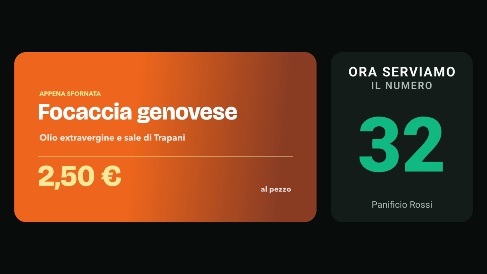</td>
    <td width="50%">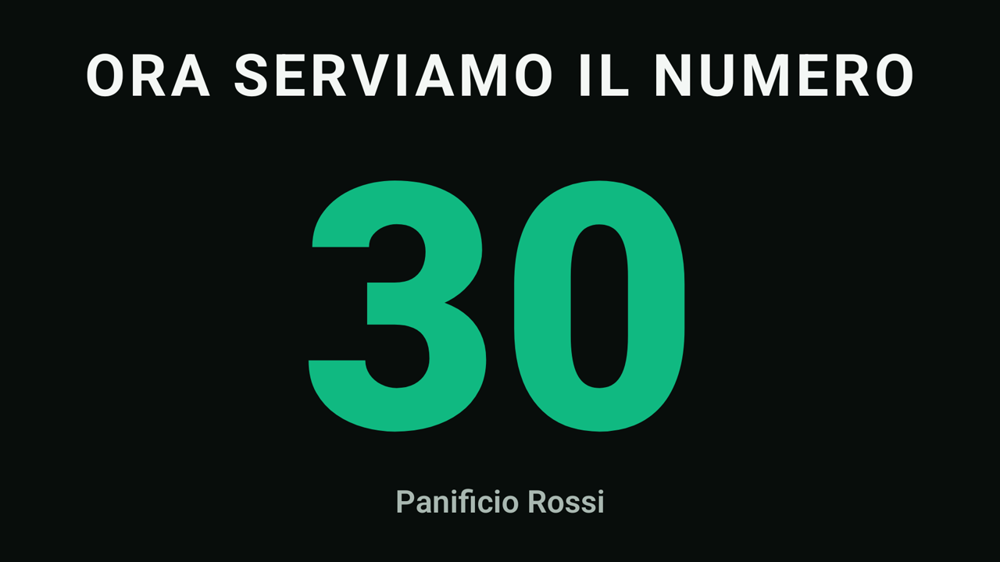</td>
  </tr>
  <tr>
    <td><b>Vetrina ed eliminacode insieme.</b> Il video sta in un riquadro, il numero accanto.</td>
    <td><b>Chiamata a tutto schermo.</b> Per 8 secondi, poi si torna ai video.</td>
  </tr>
  <tr>
    <td></td>
    <td>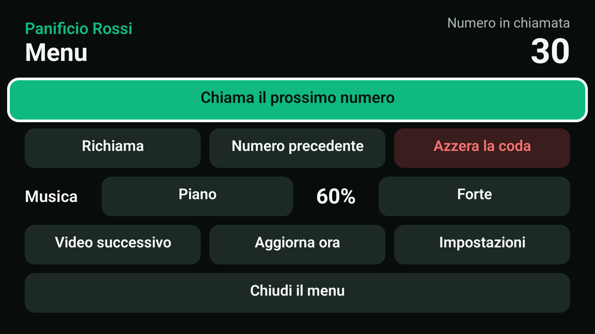</td>
  </tr>
  <tr>
    <td><b>Senza eliminacode</b> i video occupano tutto lo schermo.</td>
    <td><b>Menu a tasti grandi</b>: chiamare, richiamare, volume della musica.</td>
  </tr>
  <tr>
    <td>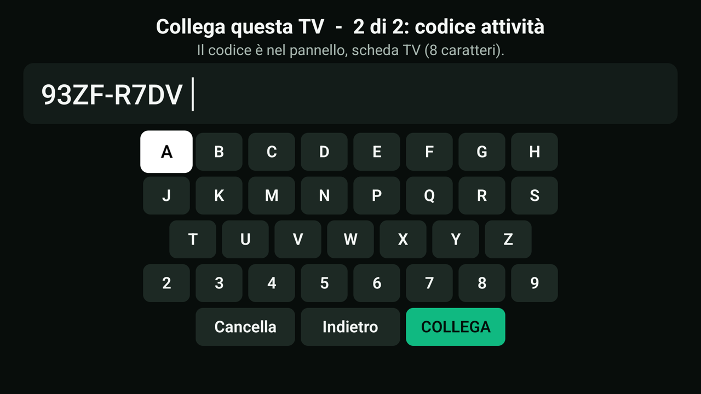</td>
    <td>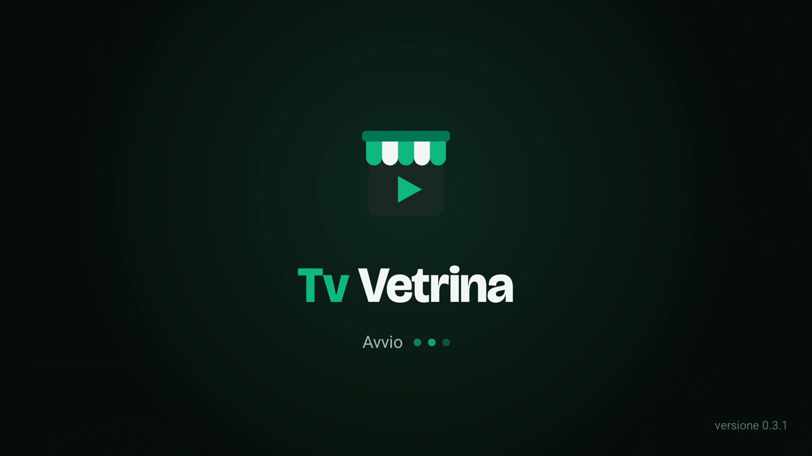</td>
  </tr>
  <tr>
    <td><b>Collegamento in due passi</b>: indirizzo del server e codice dell'attività, con il telecomando.</td>
    <td><b>Si avvia da sola</b> quando accendi la TV.</td>
  </tr>
</table>

### Comandi del telecomando

| Tasto | Cosa fa |
|---|---|
| ➡️ Destra | Chiama il prossimo numero |
| ⬅️ Sinistra | Torna al numero precedente |
| ⬆️ Su | Richiama il numero (ripete l'annuncio) |
| OK tenuto premuto | Apre il menu |

 

## Dal telefono

<table>
  <tr>
    <td width="34%" align="center">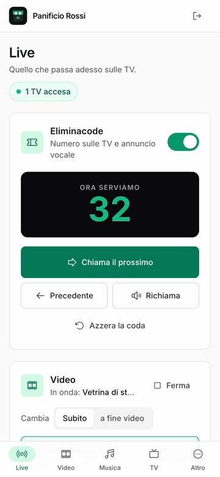</td>
    <td>

Il pannello si apre dal browser del telefono o del computer, con una password.

- **Live**: chiami i numeri, cambi la playlist in onda e regoli il volume della musica.
- **Video** e **Musica**: crei le playlist e carichi i file, anche molti insieme.
- **TV**: il codice per collegare una nuova TV e lo stato delle TV accese.
- **Altro**: nome dell'attività, colori, numeri dell'eliminacoda, voci e limiti di spazio.

Ha il tema chiaro e quello scuro, e segue le impostazioni del telefono.

</td>
  </tr>
</table>

  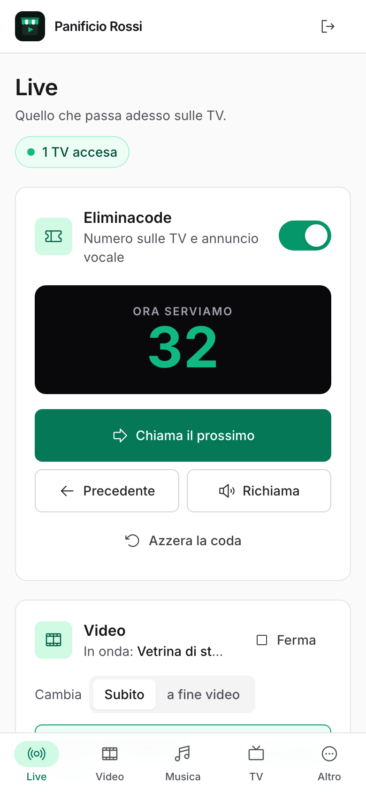
  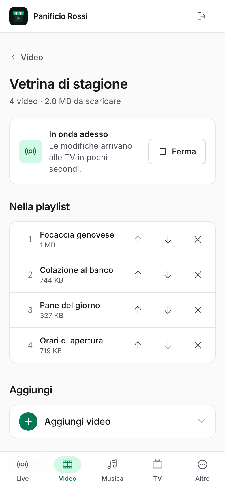
  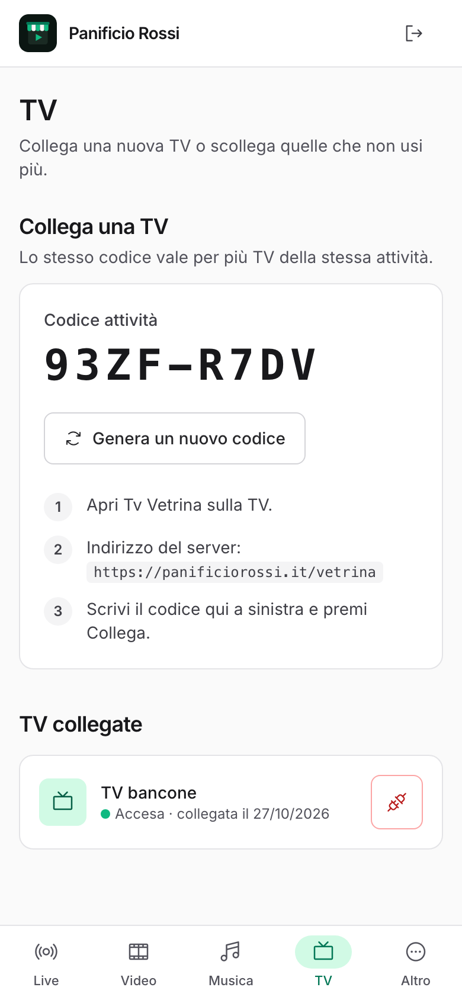
  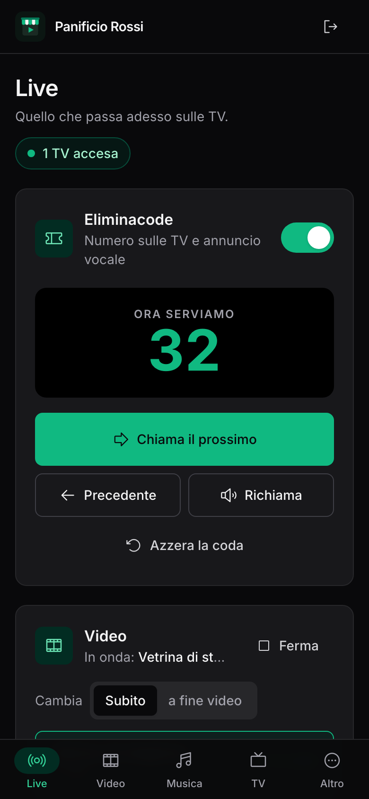

  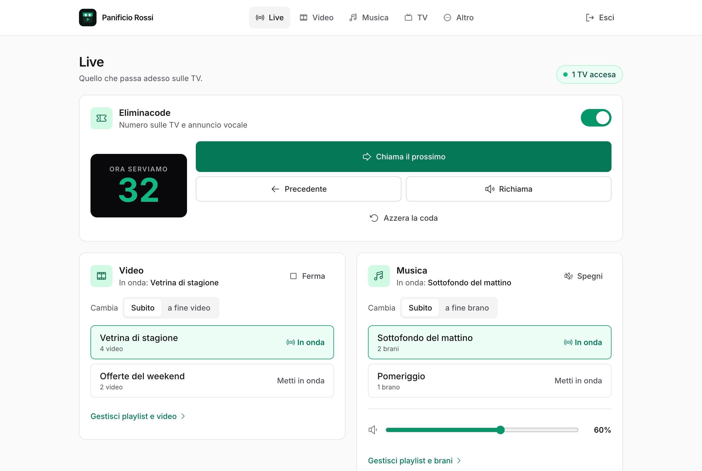

 

## Installazione guidata

Carichi i file sul tuo hosting, apri il pannello e una procedura in quattro passi controlla il server, ti fa scegliere la password e ti dà l'indirizzo e il codice da scrivere sulla TV.

  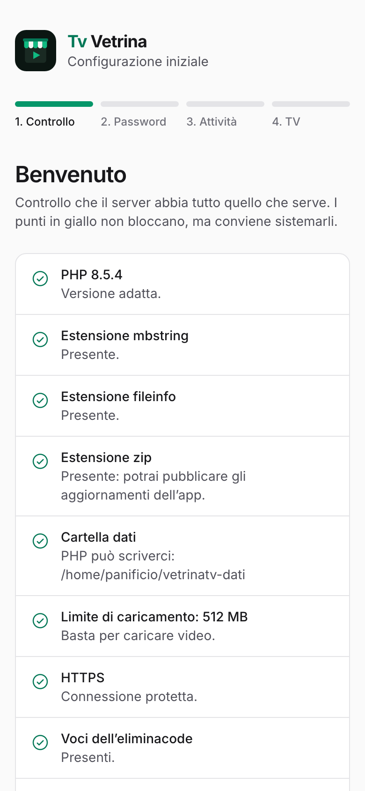
  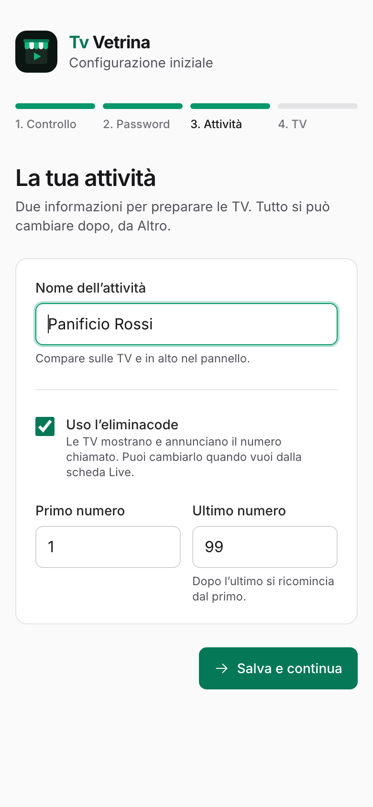
  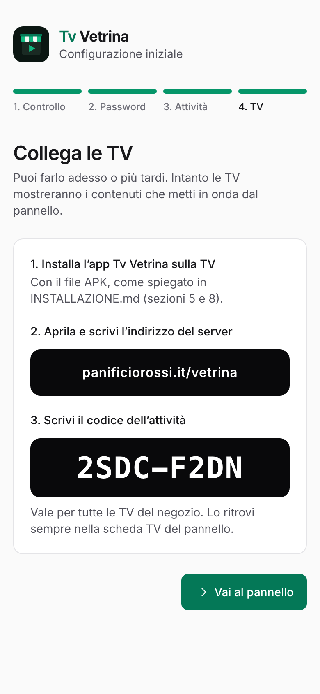

Il controllo verifica versione di PHP, estensioni, permessi, limite di caricamento, HTTPS, e che i dati non si possano scaricare da internet.

 

## Come funziona

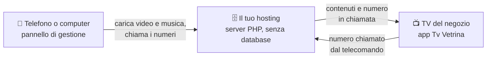

La TV scarica i file e li conserva. Ogni 20 secondi controlla se nel pannello è cambiato qualcosa: se il server non risponde, continua con quello che ha.

 

## Requisiti

| | |
|---|---|
| **TV** | Android TV, Google TV o Fire TV con Android 7.1 o successivo (Fire OS 6 o successivo) |
| **Server** | Hosting con PHP 8.1 o successivo e Apache. HTTPS consigliato. Nessun database. |
| **Spazio** | Quello dei tuoi video e della tua musica. Sulla TV i limiti predefiniti sono 2 GB per i video e 500 MB per la musica, e si cambiano dal pannello. |

 

## Come averla

Tv Vetrina non si scarica da qui: il codice non è pubblico. **La ricevi in cambio di una donazione** che sostiene lo sviluppo.

  
  &nbsp;
  

1. Fai una donazione su **[Ko-fi](https://ko-fi.com/Y0S1215ADD)**.
2. Nel messaggio della donazione scrivi **"Tv Vetrina"** e l'**indirizzo email** dove vuoi ricevere i file. Su Ko-fi puoi rendere il messaggio privato.
3. Ricevi per email il link per scaricare tutto.

Se preferisci **[PayPal](https://www.paypal.com/paypalme/fluxstreamapp)**, scrivi le stesse informazioni nella nota del pagamento.

### Cosa ricevi

- 📦 **L'app per la TV**, firmata e pronta da installare.
- 🗄️ **Il server PHP** da caricare sul tuo hosting, con la configurazione guidata.
- 📖 **La guida di installazione** passo per passo: hosting, prima configurazione, installazione sulla TV (anche Fire TV Stick).
- 🔄 **Gli aggiornamenti dell'app**: dal pannello li pubblichi sulle tue TV, che li propongono da sole.

 

## Domande frequenti

<b>Serve internet per far funzionare la TV?</b>

Serve per collegarla la prima volta e per scaricare i contenuti nuovi. Dopo, video e musica scaricati continuano anche senza connessione, e l'eliminacode funziona lo stesso: i numeri chiamati offline vengono mandati al server quando la connessione torna. Solo YouTube, Vimeo e le radio in streaming hanno bisogno di internet.

<b>Posso usarla in più negozi?</b>

Ogni attività ha la sua installazione del server, con il suo pannello e il suo codice. In un negozio puoi collegare tutte le TV che vuoi allo stesso server.

<b>Le voci dell'eliminacode sono incluse?</b>

Sì: "ding", la frase "Serviamo il numero" e i numeri da 0 a 100, in italiano. Dal pannello puoi sostituirle con le tue registrazioni.

<b>Devo pagare un abbonamento?</b>

No. Il server gira sul tuo hosting e i dati restano tuoi.

 

## Licenza

© 2026 frankcooldev. Tutti i diritti riservati. Vedi [LICENSE](LICENSE).

Gli screenshot mostrano un negozio di esempio inventato, con video e musica creati per la demo.
